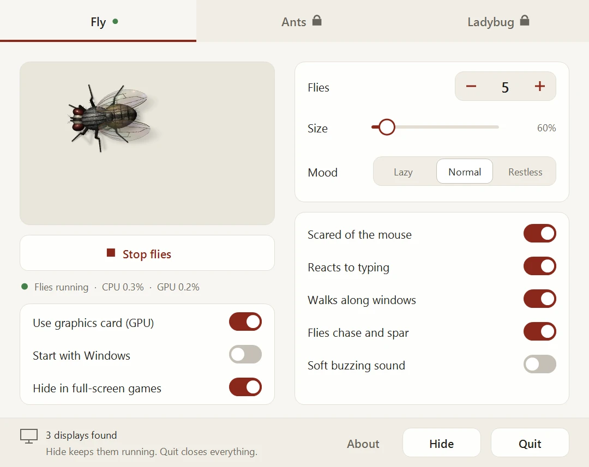

# Makkhi

Small, very realistic bugs that walk on your Windows desktop. Every click goes straight through them.

**[Download for Windows 10 and 11](https://github.com/ITECHIRFAN/makkhi/releases/latest/download/MakkhiSetup.exe)** · [Website](https://makkhi.banubibisaiyed.workers.dev)

- The **fly** is free, with no time limit.
- **Ants and ladybugs** need a one-time licence from the website.
- Stop clears the screen. Quit closes the program completely.
- It does not read your keys, files or screen. It goes online only to check a licence key.
- Installs for your user only, without administrator rights. Remove it from Windows Settings > Apps.

The installer is not yet signed with a publisher certificate, so Windows may say it does not recognise it. Each release lists the file's SHA-256. If your antivirus reports a threat, do not install it, and please tell us.

This page hosts the installer. The source code is not published. [Terms](https://makkhi.banubibisaiyed.workers.dev/terms) · [Privacy](https://makkhi.banubibisaiyed.workers.dev/privacy) · [Support](https://makkhi.banubibisaiyed.workers.dev/support)

The installer is made with [Inno Setup](https://jrsoftware.org/isinfo.php).
